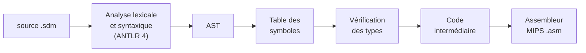

# sdmips — compilateur SDM → MIPS

Compilateur écrit en Java pour **SDM**, un petit langage impératif typé
(entiers, booléens, tableaux, fonctions récursives), qui produit de
l'**assembleur MIPS** exécutable avec les simulateurs **SPIM** ou **MARS**.



```c
int fact(int n) {
    if (n <= 1) return 1;
    else return n * fact(n - 1);
}

main() {
    int i;
    for (i = 1; i <= 5; i++;) print(fact(i));
}
```

```console
$ ./sdmips factorielle.sdm
Assembleur MIPS écrit dans factorielle.asm
$ spim -file factorielle.asm
1
2
6
24
120
```

---

## Sommaire

- [Installation](#installation)
- [Utilisation](#utilisation)
- [Le langage SDM](#le-langage-sdm)
- [Architecture du compilateur](#architecture-du-compilateur)
- [Schéma de compilation vers MIPS](#schéma-de-compilation-vers-mips)
- [Tests](#tests)
- [Limites connues](#limites-connues)

---

## Installation

### Prérequis

- **Java 17** ou plus récent (JDK : `javac` et `jar`) ;
- `make` et `curl` (ANTLR 4.13.2 est téléchargé automatiquement dans `lib/` à la
  première compilation) ;
- pour exécuter les programmes produits : **SPIM** (`sudo apt install spim`) ou
  **[MARS](https://github.com/dpetersanderson/MARS)**.

### Compilation

```bash
make          # génère l'analyseur avec ANTLR, compile, crée build/sdmips.jar
make test     # compile puis lance la suite de tests
make clean    # supprime build/
```

`build/sdmips.jar` est autonome (la bibliothèque d'exécution d'ANTLR est incluse) :
il peut être copié et lancé ailleurs avec `java -jar sdmips.jar`.

---

## Utilisation

```
sdmips [options] [fichier.sdm]

  -o FICHIER   fichier assembleur produit (défaut : fichier.asm, ou out.asm)
  -v           affiche l'AST et le code intermédiaire
  -h           aide
```

Sans fichier, le programme est lu sur l'entrée standard. Le script `./sdmips`
est un raccourci pour `java -jar build/sdmips.jar`.

```bash
./sdmips tests/ok/recursion.sdm                   # -> tests/ok/recursion.asm
spim -file tests/ok/recursion.asm                 # exécution avec SPIM
java -jar Mars4_5.jar nc tests/ok/recursion.asm   # exécution avec MARS
```

Les erreurs sont signalées avec leur position, et le compilateur s'arrête avec le
code de sortie 1 :

```
$ ./sdmips erreur.sdm
Erreur(s) de typage :
  [ligne=3, colonne=15] : argument 2 de f : int attendu (trouvé : boolean)
```

---

## Le langage SDM

Un programme est une suite de fonctions suivie de la fonction `main()`.
Une fonction peut appeler une fonction définie plus loin, et elle-même.

### Types

| Type | Valeurs |
|---|---|
| `int` | entiers signés 32 bits |
| `boolean` | `true`, `false` |
| `int[]` | tableau d'entiers, créé avec `new int[taille]` |

### Instructions

| Instruction | Exemple |
|---|---|
| déclaration | `int x;`  `boolean b = true;`  `int[] t = new int[10];` |
| affectation | `x = x + 1;`  `t[i] = 0;`  `x++;` |
| bloc | `{ ... }` |
| conditionnelle (`else` obligatoire) | `if (x > 0) print(x); else {}` |
| boucle `while` | `while (i < n) { ... }` |
| boucle `for` | `for (i = 0; i < n; i++;) { ... }` |
| retour | `return e;` |
| affichage | `print(e);` — un `int`, ou un `boolean` (affiché `true` / `false`) |

L'expression `read()` lit un entier au clavier. Les commentaires s'écrivent
`// ...` ou `/* ... */`.

### Opérateurs

Du plus prioritaire au moins prioritaire (tous associatifs à gauche) :

| Opérateurs | Opérandes | Résultat |
|---|---|---|
| `!`  `-` (unaires) | `boolean` / `int` | `boolean` / `int` |
| `*`  `/` | `int` | `int` |
| `+`  `-` | `int` | `int` |
| `<`  `<=`  `>`  `>=` | `int` | `boolean` |
| `==`  `!=` | deux valeurs de même type | `boolean` |
| `&&` | `boolean` | `boolean` |
| `\|\|` | `boolean` | `boolean` |

### Règles vérifiées à la compilation

- toute variable est déclarée avant son utilisation, une seule fois (pas de
  masquage d'une variable d'un bloc englobant) ;
- les types sont respectés dans les affectations, opérations, appels et `return` ;
- les conditions des `if` et `while` sont booléennes ;
- une fonction renvoie une valeur sur **tous** les chemins (un `return` placé
  seulement dans une boucle ne suffit pas) ;
- aucune instruction ne suit un `return` ;
- une fonction a au plus 4 paramètres et n'est définie qu'une fois.

La grammaire complète est dans [`grammar/Sdm.g4`](grammar/Sdm.g4), et de
nombreux exemples dans [`tests/ok/`](tests/ok/) (récursivité croisée, tri de
tableau, PGCD, lecture au clavier…).

---

## Architecture du compilateur

```
grammar/Sdm.g4          grammaire ANTLR (analyseurs générés dans build/generated/)
src/
├── main/Main.java      point d'entrée, ligne de commande, enchaînement des étapes
├── ast/                arbre de syntaxe abstraite + AstBuild (arbre ANTLR -> AST)
├── semantic/           table des symboles (TableBuilder) et typage (TypeChecker)
├── ir/                 code intermédiaire : registres virtuels, cadres, commandes
│   └── translation/    Translate : AST -> code intermédiaire
├── mips/               code intermédiaire -> assembleur MIPS
├── printers/           affichage de l'AST et du code intermédiaire (option -v)
└── support/            erreurs, paires, listes
runtime/                routines MIPS ajoutées à chaque programme
                        (affichage, lecture, allocation sur le tas)
tests/                  suite de tests (programmes valides et invalides)
```

Le parcours des arbres utilise le patron **visiteur** : chaque étape (typage,
traduction, affichage) est un visiteur de l'AST ou du code intermédiaire.

Quelques constructions sont réécrites dès la construction de l'AST :
`x++` devient `x = x + 1`, `for` devient un `while`, `int x = e;` devient une
déclaration suivie d'une affectation, et `main` devient une fonction `int`
qui renvoie 0.

### Code intermédiaire

Le code intermédiaire manipule un nombre illimité de **registres virtuels**
(une variable = un registre) et se compose de commandes simples :
affectation de registre, écriture mémoire, saut, saut conditionnel, label et
appel de fonction. L'option `-v` l'affiche :

```
Frame{entrée=L0, sortie=L1, paramètres=[reg0], résultat=reg1, locaux=[reg3]}
    CJump ((reg0 <= 1), L4, L5)
L4:
    reg1 := 1
    goto L1
    goto L6
L5:
    reg3 := call L0[(reg0 - 1)]
    reg1 := (reg3 * reg0)
    goto L1
L6:
```

---

## Schéma de compilation vers MIPS

- **Expressions** : modèle de machine à pile. Le code d'une expression laisse sa
  valeur au sommet de la pile ; une opération binaire dépile ses deux opérandes
  dans `$t0` et `$t1` puis empile le résultat.
- **Registres virtuels** : chacun occupe une case du cadre de pile de sa
  fonction, à un décalage fixe par rapport à `$fp` (pas d'allocation de
  registres).
- **Appels** : les arguments (4 au plus) sont passés dans `$a0`–`$a3`, le
  résultat revient dans `$v0`. Le prologue sauvegarde `$ra` et `$fp`, l'épilogue
  les restaure.
- **Tableaux** : alloués sur le tas par l'appel système `sbrk` ; une variable de
  type `int[]` contient l'adresse du tableau, et `t[i]` est à l'adresse `t + 4*i`.
- **Booléens** : codés 0 / 1.

Cadre de pile d'une fonction ayant N registres virtuels :

```
          adresses hautes
 $fp  ->  registre virtuel 0          0($fp)
          registre virtuel 1         -4($fp)
          ...
          ancien $fp                -4N($fp)
          adresse de retour ($ra)   -4(N+1)($fp)
 $sp  ->  première case libre
          adresses basses
```

---

## Tests

```bash
make test
```

| Dossier | Contenu | Vérification |
|---|---|---|
| `tests/ok/` | 14 programmes valides | le programme est compilé, exécuté avec SPIM, et sa sortie comparée au fichier `.attendu` (entrée clavier dans `.entree` si besoin) |
| `tests/erreurs/` | 20 programmes invalides | la compilation doit échouer avec le message indiqué en première ligne (`// ERREUR : ...`) |

Pour utiliser MARS au lieu de SPIM :

```bash
MARS_JAR=/chemin/vers/Mars4_5.jar make test
```

---

## Limites connues

- pas de vérification des bornes des tableaux à l'exécution ;
- `&&` et `||` évaluent toujours leurs deux opérandes (pas d'évaluation paresseuse) ;
- pas de fonctions sans valeur de retour, ni de variables globales ;
- toutes les valeurs intermédiaires transitent par la pile : le code produit
  est simple mais peu optimisé.
